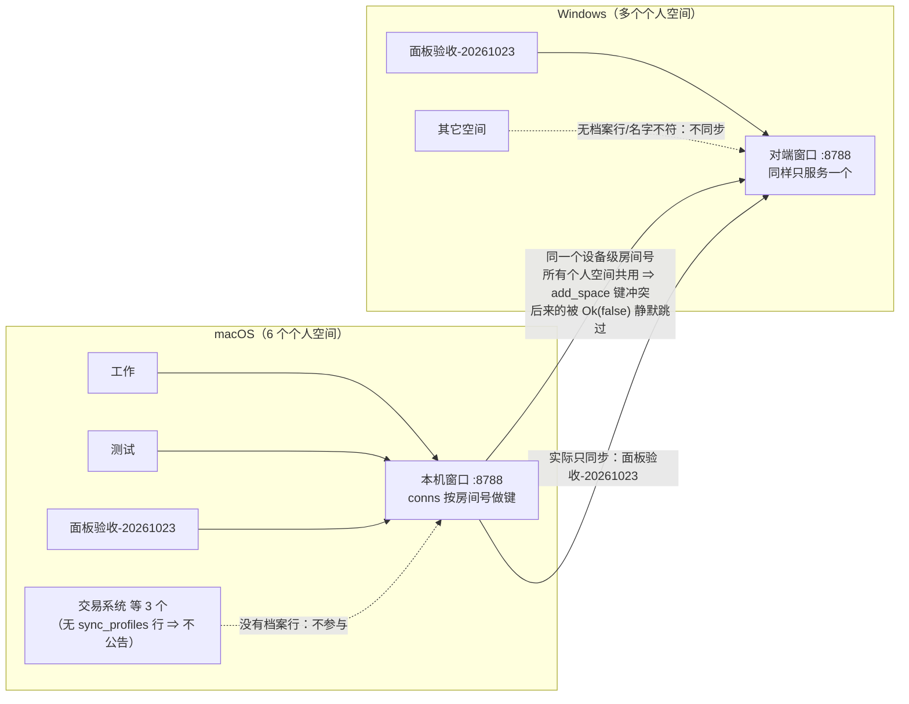
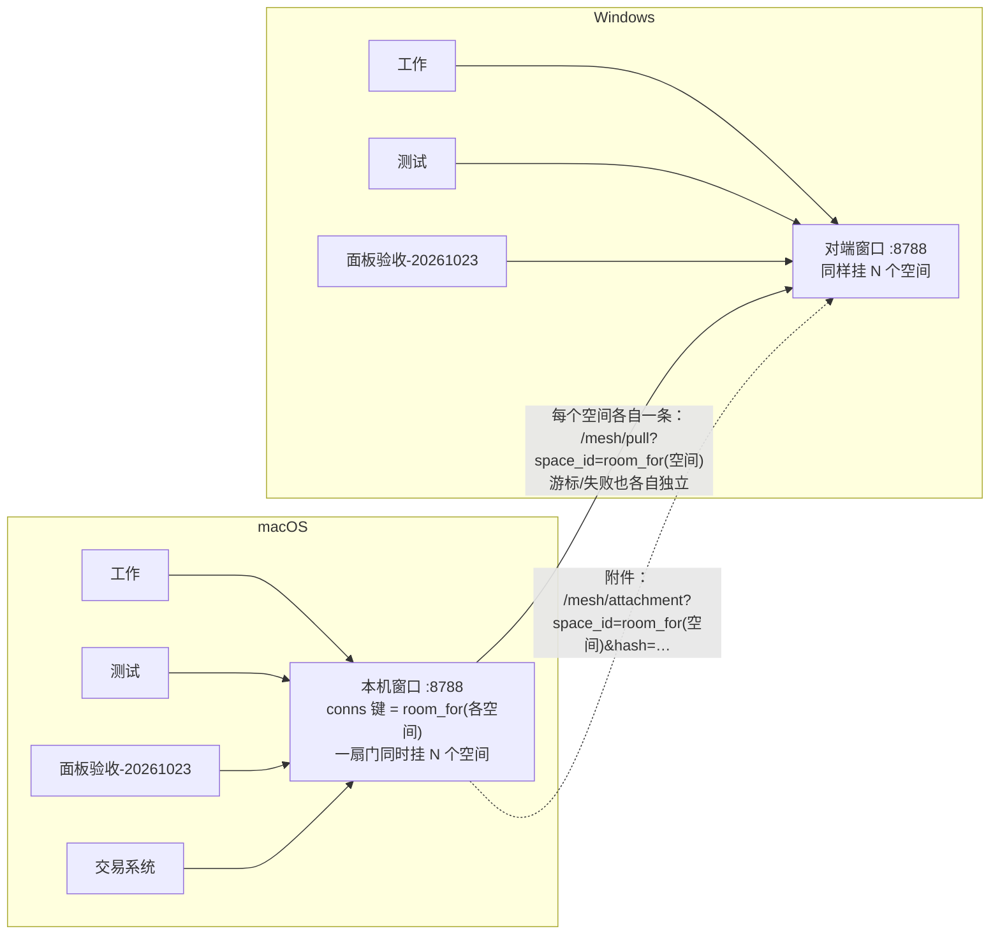
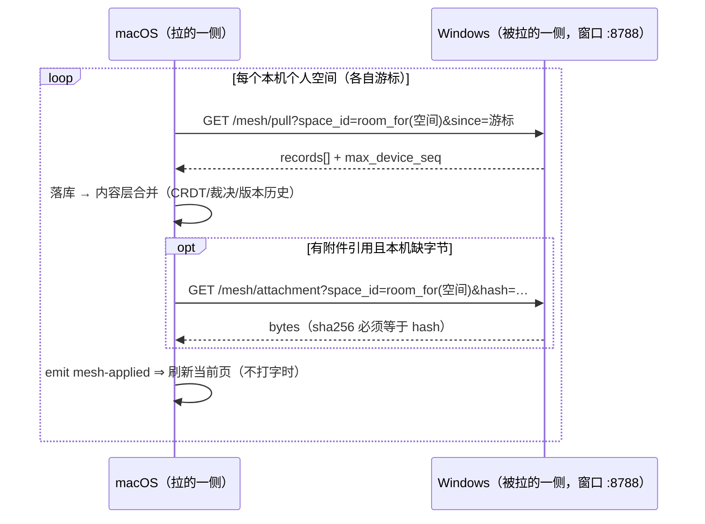
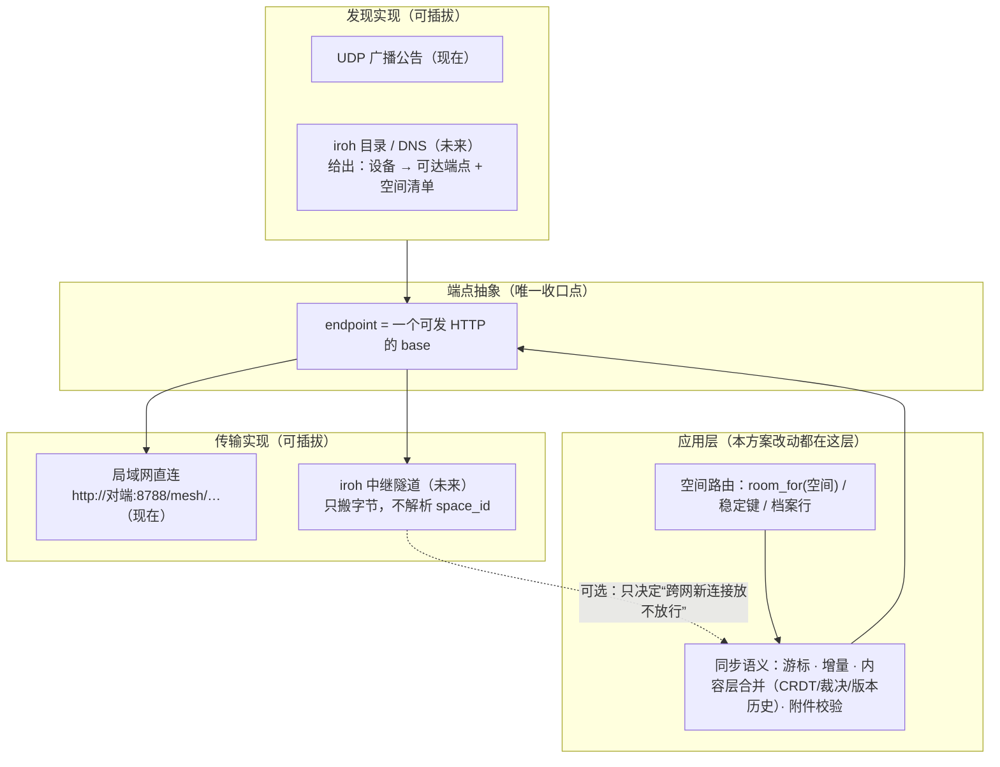

# 个人版「全空间」局域网多端同步方案（含传输/发现抽象层）

> **状态**：**实施中（P0/P1 已落并两机真机验收通过；P2 逐名对账/收尾与 P3 未做）**。本文是方案书 ＋ 施工单 ＋ 实施记录（§九）。
> **一句话目标**：个人版**不依赖服务器**，让一台机器上的**所有个人空间**（不是一次一个）在局域网内
> 同时、双向、可收敛地同步到同一个人名下的其它设备。
> **范围**：客户端为主（`src-tauri/src/{mesh,sync,lan_state,db}.rs`、`src/components/SyncPanel.tsx`）；
> **不改服务端**（个人版不走服务器；团队/服务器通道行为一个字不动）。
> **与既有方案的关系**：承接 `plans/2026-10-11-personal-mesh-device-level.md`（个人空间＝设备级）
> 与 `plans/2026-10-23-sync-while-locked.md`（锁定态封包），**不推翻**它们，只把「一次一个空间」
> 这个限制拿掉。

---

## 一、现象与根因（真机 2026-10-24，逐条有出处）

### 现象

```text
macOS 侧 6 个空间：工作 / 测试 / 面板验收-20261023 / LAN-CRDT-TEST-20261023 / 交易系统 / 濮阳数友
Windows 侧也有若干空间；实际能同步的只有「面板验收-20261023」这一个（偶尔只有它被服务）。
```

### 根因（三条叠加）

```text
① **档案行是入场券**：网格的公告与每轮拉取只遍历**有 `sync_profiles` 行**的空间。
   实测（本机 meta.db）：6 个空间里只有 3 个有行（工作 / 测试 / 面板验收-20261023），
   另外 3 个 **0 行** ⇒ 从不公告、从不进轮次。
   来由：旧版「面板保存设置」只写 `mesh_bind` 键、不补档案行；新提交 `585dc349` / `18e473fc`
   只修了「新建/自动建空间」，**既有空间不会自动补**。

② **所有个人空间共用同一个房间号**：个人档（`sync_profiles.space_id` 为空）在
   `sync.rs` 的 `mesh_scope_at`（约 `5469` 行起）里解析出的 proto 值＝设备级房间号
   `mesh_room` ⇒ 多个个人空间映射到**同一个键**。
   而窗口的连接表就是按 proto 值做键（`mesh.rs` 的 `add_space`，约 `2550` 行）：
   **键已存在 ⇒ 直接 `Ok(false)` 静默跳过** ⇒ 一台机器的窗口同一时刻**只服务一个个人空间**。

③ **公告/匹配按名字 + 一次一条**：公告每个 profile 一条（`lan_state.rs` 约 `578` 行），
   对端按名字匹配（`mesh_peers_by_name`），且融合要求**名字逐字相同 + kind=personal**（owner 2026-10-17 口径）。
   ⇒ 只有「两边都有档案行、且同名」的那一个空间能同步；其余要么不公告，要么名字对不上被拒。
```

### 现状图解（为什么“一次只有一个空间”）



## 二、方案 A（推荐）：**一空间一房间号（子房间号）**

### 核心一句话

把「全设备共用一个房间号」改成「**每个个人空间一个有确定性派生值的子房间号**」——
两端算法相同 ⇒ 算出的子房间号必然相同；窗口的连接表天然多键、路由不用重写；
对端按子房间号精确取。

```text
room_for(space) = sha256( seed ‖ "|" ‖ stable_key )[..16]

· seed：两端都持有的共享种子。首选**配对账本里存的随机值**（见 §二.2）；
        过渡期可先用现有设备级房间号 `mesh_room`（它已退役「凭证」身份，只作种子）
· stable_key：空间的稳定键。首次融合时写进 `mesh_merge_ledger` 的 (空间名 → 稳定键)，
        随同步传播 ⇒ **改名不漂移**；未融合过的新空间用「名字小写归一」作 key
```

### 目标图解（一空间一子房间号 ⇒ 窗口多挂、全空间同时同步）



### 1）数据与公告

```text
· 启动迁移：给所有 kind=personal 且无 `sync_profiles` 行的空间**补一行空档案**（幂等）
  判据：本机 6/6 有行；公告里 6 个名字都出现（今天只有 3 个）
· 每个空间一条公告（现有形状不变）：
    hub_spaces      = [room_for(空间)]
    hub_space_names = [空间名]
    hub_space_kinds = ["personal"]
  公告里加能力标记 `caps="room2"`（老对端无此标记 ⇒ 只走旧共享房间，见 §四.3）
```

### 2）配对账本与稳定键

```text
· 配对成功后，在 `mesh_merge_ledger`（已有表）里记：
    (对端设备, 空间名, 稳定键, room_for(空间), 首次配对时间)
· 任一侧导入/新建同名空间时，先查账本：有记录 ⇒ 复用稳定键；没有 ⇒ 生成并记下
  ⇒ 即使空间改名（改名会改 room_for），也能从账本找回「它原来是谁」并重发公告
· ⛔ 不新增第二份真相源：账本就用现有 `mesh_merge_ledger`，只加列（加法迁移）
```

### 3）窗口与轮次

```text
· 窗口：现有 `conns: HashMap<proto_space, conn>` 结构不变；
  因为个人空间的 proto 现在是各不相同的 room_for(空间)，`add_space` 不再互相覆盖
  ⇒ 「一扇门同时服务多个个人空间」自然成立（不需要改 select_space 的路由形状）
· 轮次：后台轮遍历**全部有档案行的空间**（今天固定 3 个，改后 6 个 → 用户有几个空间就跑几个）；
  每个空间独立 cursor、独立失败记录；锁着/打不开的走现有 sealed 路径，互不连累
· 附件：`/mesh/attachment?space_id=<room_for(空间)>&hash=…` ⇒ 窗口按 conn 定位本地空间，
  目录照旧按本地空间取（现有 `space_attachments_dir` 已按 db_space 分目录）
```

### 一轮同步的时序（目标形态，多空间并行）



### 4）兼容与回退

```text
· 旧对端（公告无 room2）：只按旧共享房间同步「主空间」，界面/历史**如实写**
  「对端版本旧 ⇒ 只同步主空间」，⛔ 不假装全同步
· 本机降级：把账本标记保留、`caps` 不写 room2 即可回到旧行为（数据不迁移、不回滚）
· 名字冲突：两个不同空间同名 ⇒ 融合闸门按 owner 口径**拒绝并如实报**，不猜
```

## 三、方案 B（备选，不首选）：**name_sha 路由**

```text
房间号语义不动（仍共用），拉取/附件请求都带 `?name_sha=sha256(空间名)`
（锁定态那条路已经在用这个参数），窗口 select_space 先按 proto 再按 name_sha 选 conn。
· 优点：对旧对端最友好（多一个参数，缺省行为不变）
· 缺点：两处路由（pull + attachment）都要改，「服务了哪些空间」的口径也要跟着改；
  与「锁定态/封包」那套的 name_sha 语义要统一（否则同一个参数两种含义 = 两份真相源）
⇒ 相比之下 A 更顺现有结构（conns 本来就是 map），故选 A、留 B 作回退脑图。
```

## 四、⭐ 传输 / 发现抽象层（与 iroh 中继的关系）

> 背景：仓库已有 `src-tauri/src/relay_client.rs`（跨网中继客户端，接上游 `iroh-relay` 协议），
> 但**今天只做到**：读配置 → 握手 → 判「许可窗口放不放行」；**同步载荷还没有经中继搬过一次**，
> 设备私钥与长期许可公钥仍是占位（见该文件头注）。个人版「不走服务器」指**不走同步服务器（甲）**；
> 中继是可选的**跨网桥**（独立商业组件），不是同步前提。

### 分层图解（应用层不变；传输/发现可替换；中继只是可选的一条路）



### 1）一条原则：**同步逻辑只认「端点」，不认「怎么连上的」**

```text
· pull / attachment 的调用面收一个 `endpoint`：
    局域网直连 → `http://<peer_base>/mesh/…`（现在这套）
    跨网      → 中继隧道提供的等价 base（未来）
· 上层（空间路由、子房间号、游标、合并、附件校验）**完全不变**；
  中继只是把同样的 HTTP 请求搬过去 —— 它不解析 space_id / 子房间号
· 判据：把 endpoint 换成直连或隧道，同一套空间路由与合并判据都必须绿
```

### 2）发现层可插拔：公告 = 「设备 × 空间清单」的一种载体

```text
· 现在：局域网 UDP 广播公告（`lan_state`，每个空间一条，带 room_for/名字/类别）
· 跨网：没有广播 ⇒ 需要等价物（iroh 目录 / DNS / 中继侧登记）
  ⇒ 抽象成「发现源」：给出一份 (对端设备, 可达 endpoint, 空间清单) 列表
      · 广播源：现成的（不改协议）
      · 目录源：未来接 iroh 发现；字段与广播一一对应（空间名、类别、子房间号）
· ⛔ 全空间同步**不许**写死成「只依赖广播」；广播只是第一个发现源实现
```

### 3）与 iroh 中继的四个对齐点（现在就要定死）

```text
① **隧道按设备复用，⛔ 不按空间**
   子房间号只出现在应用层请求里；一条设备隧道多路复用多个空间的 HTTP 请求。
   否则空间一多，连接/租约按空间数爆炸。

② **身份统一成一套**
   配对换来的「设备卡」与中继握手的「设备私钥」应是同一个设备身份
   （现在 relay 配置里 `device_seed_hex` 还是占位）⇒ 未来合并，⛔ 不造两套身份。
   子房间号与身份无关：它只是「在哪见面」，不是「你是谁」。

③ **中继只决定「跨网新连接放不放行」**
   租约到期/被拒 ⇒ 只收回「跨网」，局域网直连与本地功能一个字不变
   （`relay_client.rs` 头注已写死这条口径）。全空间同步**不依赖**中继存在。

④ **商业/许可边界**
   中继是可选商业组件；个人版默认不配置它也能全功能（局域网内）。
   验收判据里**排除中继依赖**：没有 `relay/config.json` 时，全空间同步必须照常全绿。
```

### 4）需要补的文档口径

```text
· 把「endpoint 抽象 / 发现源抽象 / 隧道按设备复用」写进 `plans/2026-09-29-personal-edition-spec.md`
  的同步章节（或本方案 §四 作为引用源），避免下一轮实现时又造第二套连接管理。
· relay 那一侧（`repos/shuyonote-relay`，专有）只要求：**隧道承载任意 HTTP 请求，不解析业务字段**；
  若它将来要按空间做目录，必须复用本方案的 room_for / 空间稳定键口径，⛔ 不另造映射。
```

## 五、分阶段落地（每步都有判据，先写先红）

```text
P0（约半天）· 补档案行迁移（§二.1 第一段）
  · 改动：启动迁移 + `mesh_set_config` 对个人空间 upsert 档案行（已有 585dc349 的一半）
  · 判据：新装/升级库跑完后，本机所有 personal 空间都有行；公告里 N 个名字（N=空间数）；
          单测：无行空间补行幂等、不覆盖已有行
  · 真机读数：公告从 3 个名字变 6 个（但受根因②限制，同时仍只服务一个 —— 这一步只验"被看见"）

P1（约 1–1.5 天）· 子房间号 + 窗口多挂 + 轮次全空间
  · 改动：room_for/稳定键（账本加法列）、mesh_scope_at 个人档返回 room_for、
          公告 caps=room2、后台轮遍历全部空间、附件按 room 路由
  · 判据（先红）：
      - 单测：room_for 确定性（同输入同输出）＋ 不同空间不同值
      - 单测：窗口 add_space 两个个人空间**不同键**（今天会红：第二个被 Ok(false) 跳过）
      - 夹具：两窗口各 3 个同名个人空间 ⇒ 每空间都能 pull 到**各自库**的记录且不串库
      - 旧对端公告（无 room2）⇒ 只同步主空间，且报告里如实写
  · 验收：6 空间 × 每空间 3 页 × 附件双向；每空间单独记账

P2（约 0.5–1 天）· 真机验收矩阵 + CI 判据
  · 判据脚本：有行空间数 = 同步成功空间数；失败必须带原因（没公告/名字不符/锁着/网络）
  · 真机：macOS ↔ Windows 双向，包含真并发一轮（沿用 `concur.json` 账本口径）

P3（后续）· 改名策略与 UI
  · 改名：账本稳定键 → 重发公告、旧记录保留 30 天；界面如实说"空间已改名，需要对方确认"
  · UI：同步面板按空间显示状态（已同步/等对端/对端版本旧/锁着）
```

## 六、风险与回退

```text
· 旧对端兼容：caps=room2 是渐进开关；老对端只同步主空间，且**明说**
· 改名漂移：靠账本稳定键；本期先做到"改名后需一次确认"，不承诺零感知
· 空间数多：轮次时长线性增长（每空间一轮网络往返）⇒ 保持"失败不连累"、
  并可后续做"本轮只跑有变化的/指数退避"（不在本期）
· 加密空间：沿用 sealed/封包路径，只换成"每空间各走各的"；锁着不影响其它空间
· 回退：保留账本与 caps 标记，关掉 room2 即回旧行为（数据不迁移）
```

## 七、不做什么

```text
· ⛔ 不走服务器、⛔ 不需要公网账号、⛔ 不把「全空间」建立在中继可用之上
· ⛔ 不每空间开一个端口/窗口（N 个 listener 的公告、防火墙、重连复杂度不可控）
· ⛔ 不靠 round-robin 切空间（会掐断对端正在走的链路）
· ⛔ 不改团队空间行为（团队仍按 space_id 绑定，逐空间是有意的）
· ⛔ 不为「全空间」再写第二份合并逻辑（仍走现有 CRDT/裁决/版本历史）
```

## 八、待拍板（需要 owner 一句）

```text
1. seed 选谁：① 现设备级房间号（改动最小） ② 配对账本里新存的随机值（更干净、但要迁移一次）
   —— 推荐 ②；沉默 ⇒ 按 ① 先行、把接口留成可替换
2. 稳定键的生成时机：首次融合时生成（推荐）／用户手动确认后生成
3. P1 是否连 P3 的「按空间状态 UI」一起做（推荐分开，先让同步本身全绿）
```

---

## 九、实施记录（2026-10-24）

### 已落地

```text
P0 补档案行（启动迁移）
  · `sync::ensure_sync_profiles_for_personal_spaces`：只补 `kind='personal'`、未删除、**还没有行**的空间；
    空档案（服务器地址/空间 id 都空 ⇒ 个人档只走网格）；幂等
  · `db::init` 启动时调用（失败只记一行，不打断启动 —— 与发现层同一条口径）
  · 判据：`personal_room_and_backfill_tests::backfill_gives_every_personal_space_a_profile_row_once`

P1 一空间一子房间号
  · `sync::personal_room_for(seed, 空间名)`：sha256 前 32 位十六进制，确定性、不同空间不同值
  · `sync::mesh_scope_at` 个人档：改为返回**这个空间自己的**子房间号（seed＝设备级配对暗号，
    回落旧逐空间那一格；空间名来自 workspaces）⇒ 窗口连接表天然多键、`select_space` 路由不用改
  · `mesh::is_device_level_space`：派生出来的房间号**也算个人档**（否则配对秘密/卡表从团队行走 ⇒ 401）
  · `lan_state` 建窗口：个人档判据改用 **`space_id` 空**（⛔ 不再拿"房间号==设备级暗号"反推）
  · 公告/取数/附件：全部走同一条解析（`window_serve_space` → `mesh_scope_at`），
    所以一条改完，公告、窗口服务、每轮拉取、按需取字节**用的是同一把尺**
  · 判据（含先看红的那条）：`multi_space_window_tests::a_window_serves_several_personal_spaces_at_once`
    （两个个人空间在同一扇门里**都在服务**；摘掉一个不掐断另一个）、
    `a_derived_room_still_counts_as_a_personal_space`、`r146_mesh_scope_tests::one_device_level_write_...`
    （改成断言"两个个人空间**不再共用**同一个房间号"）、
    `direct_sync_tests` / `personal_profile_scope_...`（公告与 scope 同一把尺，期望值改为子房间号）
```

P1 追加：**同一台设备的多条公告必须合并**（真机验收抓出的第二个坑）
  · 症：一台机器**每个空间发一条**公告；对端表按 `device_id` 做键、原来是**整条替换** ⇒
    表里永远只剩**最后到的那一条** ⇒ 「一空间一子房间号」落地后，**每台设备每轮只有一个空间**
    能配上对端（实测：7 个空间里只有最后公告的 `66ac…` 候选 1，其余 6 个候选 0）
  · 修：`lan::PeerTable::upsert` 改为按 `hub_spaces` **求并集**（名字/类别按同一下标对齐；
    其余字段"最新优先、空值不覆盖"）＋ 判据 `multi_space_peer_table_tests`（2 条：
    两空间公告合并成一条对端、同空间新公告不挤掉其它空间）
  · 修后真机：后台轮 `11 个空间`，7 个空间里 **6 个候选 1**，逐空间收下 12/0/3/4/0/25 条；
    `工作` 候选 0（Windows 侧没有同名空间 —— 属"名字不同 ⇒ 不同步"的既有口径）

### 验证读数（2026-10-24 本机）

```text
· `cargo test --lib`：1167 passed / 3 failed —— 3 条全是 macOS `/var` vs `/private/var` 的
  `workspaces::tests` **既有**失败（与本笔无关，改动前就是 3 条）
· `node scripts/test-report.mjs`：66 条门禁全绿
· `check-doc-content-access`：生产面 560/562（**低于**基线；新测试模块放在文件末的测试尾部之后，
  遵守"测试不计入替换面"的口径，且没有新增直接访问）
· `check-plan-status` / `check-doc-links` / `fence-balance`：通过
```

### ⚠️ 协议变更（升级须知）

```text
这一版把个人空间的"对暗号值"从**一个共享房间号**改成**每空间派生子房间号** ⇒ 公告里的
`hub_spaces` 也变了。
· 两台都升级：各空间的子房间号一致 ⇒ 正常；首轮会从游标 0 重拉（幂等，量大但不丢）
· 一台没升级：它公告的是旧共享房间号 ⇒ 与本机的子房间号**匹配不上** ⇒
  如实表现为"网段里没有能直接拉的对端"（⛔ 不会误合并，但也同步不了）
  ⇒ 真机验收要求**两侧同时**换新版；"对端版本旧"的专门提示留 P3
```

P1 追加之二：**融合闸的"对面名字"要取公告名，⛔ 不从旧载荷里扫**（owner 反馈"win 的空间没有同步完成"后查出）
  · 症：刚自动建的「产品 / 运营」两个空间每轮 `applied=0`、游标恒 0、**永远同步不完**
    （实测：280 / 179 条每轮重拉）—— 日志写着「**不融合**（名字不一样）」而两边名字都是同一个
  · 根因：Windows 那两个空间的 `changes` 里混着**老记录**，载荷里带着**别的空间名的历史残留**
    （`_space_name`）；旧实现"从这一批里扫第一个带名的记录"⇒ 扫到那个旧名 ⇒ `RefuseDifferentName`
    ⇒ 整批不落库、水位不前进（**如实拒绝，但对象取错了**）
  · 修：`absorb_peer_batch` 收一个 `peer_name_hint` —— 由 `pull_and_absorb` 传**本机空间名**
    （调用方在 `mesh_peers_by_name` 里已经按公告名配过对，公告名才是权威）；
    不给 hint 的老调用点/判据仍走旧口径（⛔ 不猜）
  · 判据：`a_batch_with_a_stale_payload_name_is_still_merged_when_the_advertised_name_matches`
    （载荷带旧名 + hint 对 ⇒ 融合落库；不给 hint ⇒ 仍拒绝）

### P2 两机真机验收（2026-10-24 14:1x–14:4x，macOS ↔ Windows）

```text
版本：两侧都升到 `338307fc`（含「设备多条公告合并」那一笔）之后
一空间一子房间号：✓
  · 我侧公告 **11 个子房间号**、窗口服务 11 个空间；Windows served **10**、两组**交集 10/10**
  · 我侧多出的 1 个是「工作」（f33905aa…）—— Windows **没有同名空间** ⇒ 无对应是正确的
  · Windows 少 1 个是「保险柜」—— `encrypted=1` ⇒ **加密空间不参与按名融合**（符合预期）
每空间能配上：✓
  · 我侧后台轮 11 个空间：**10 个候选 1**（唯一 0 是「工作」，无同名对端）
  · Windows 逐空间 mesh_sync_now：**10/10 candidates=1**（以前只有 1 个）
首轮游标 0 全量重拉后的页数（我侧，升级前 → 现在）：
  测试 3→13 ｜ 面板验收 13→15 ｜ LAN-CRDT-TEST 0→1 ｜ 交易系统 0→2
  客户&伙伴 0→11 ｜ 山焦招标 0→42 ｜ 数友标尺 0→9 ｜ 工作 13（无可比对象）
  濮阳数友/产品/运营 0（两侧本来就空）
跨空间不串：✓ 11 个空间库的 page id **跨空间重复 0 个**
自动建空间：✓ 我侧按 Windows 公告里的新名字自动建了 4 个（产品/山焦招标/数友标尺/运营），
            子房间号指纹与 Windows 逐一对上（10/10 交集）
待收尾：Windows 侧同名 10 空间的页数逐名对账；Windows 侧「两空间各写一笔」的串空间测试
```

### 还没做的（P2/P3）

```text
· P2：两机真机验收矩阵（每空间各建/改一页、附件、封面；双向对账）
· P3：改名策略（账本稳定键 + 旧记录保留期）、同步面板"按空间状态"、旧对端版本提示
```

---

**依据/关联**：
`plans/2026-10-11-personal-mesh-device-level.md`（个人空间设备级）、
`plans/2026-10-23-sync-while-locked.md`（锁定态封包，S3 顺带修「一个锁着的空间按死整扇门」）、
`src-tauri/src/mesh.rs`（窗口 conns/add_space/select_space）、
`src-tauri/src/sync.rs`（`mesh_scope_at` 个人档房间解析）、
`src-tauri/src/lan_state.rs`（公告产出）、
`src-tauri/src/relay_client.rs`（iroh 中继客户端现状：只握手/许可，未搬同步载荷）。
