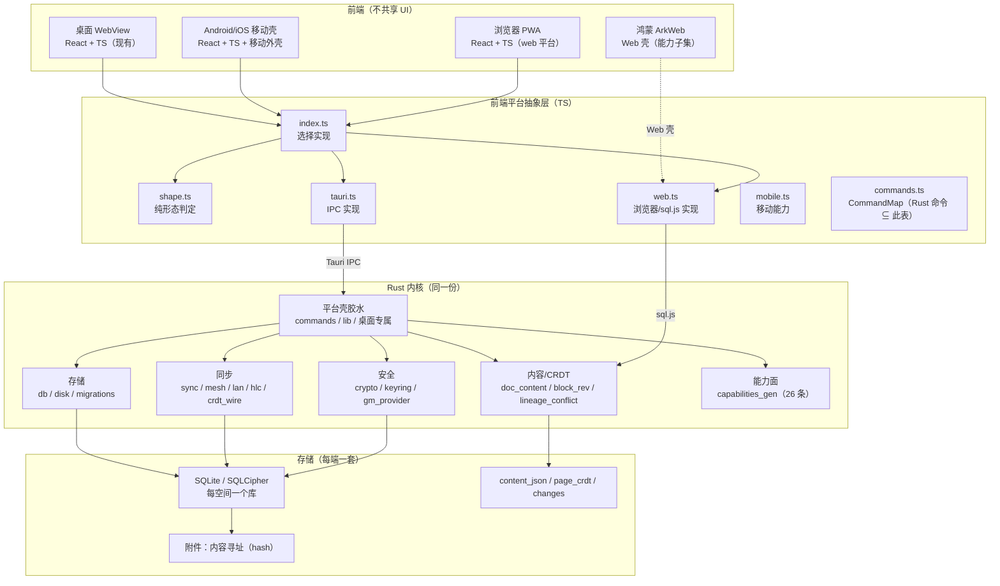
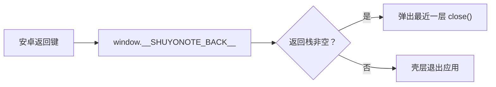
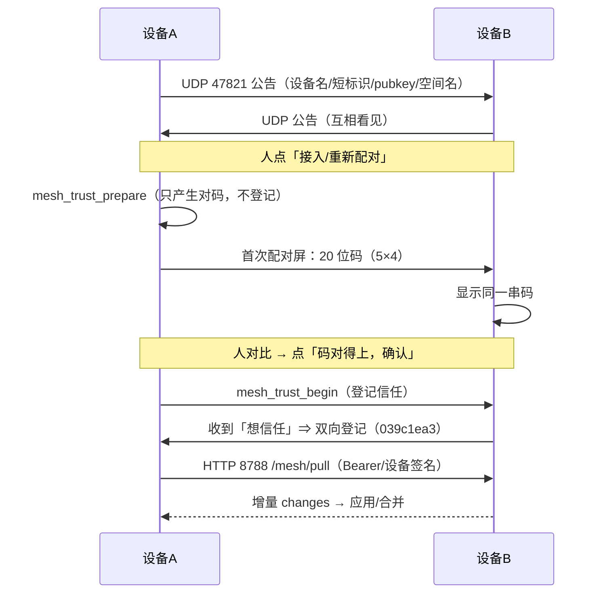

# 移动端技术方案（完整版）

> 文档编号：`MOBILE-TECH-2026-10-20`　｜　版本：v2.4（完整版；1.92.24 实况）
> 状态：现行（实况基线 2026-10-23；未收口项逐条标注）
> 基线：应用仓 `dev`（2026-10-23）· 移动版号 `1.92.24` · Tauri 2（crate 2.11.5 / CLI 2.11.4）· React 18 + TS
> iOS：打包链路已打通（2026-10-20，见 [`2026-10-20-ios-packaging-recipe.md`](./2026-10-20-ios-packaging-recipe.md)）；
> 界面/真机仍待验。
> 视觉基线：**2026-10-20 浅色明快卡片版重设计**（[`mockups/2026-10-20-redesign/`](./mockups/2026-10-20-redesign/README.md)）；
> ✅ **视觉层已落地（2026-10-20）**（`App.css` 移动覆盖 ＋ `Mobile*.tsx` ＋ `index.html` 启动页）；⛔ **真机观感待签**。
> 取代关系：本文**取代** [`2026-10-08-mobile-tech-plan.md`](./2026-10-08-mobile-tech-plan.md) 的整体方案。
> 旧稿里「切 `crates/core` ＋ uniffi 桥接」是**当时提出、后来没有采用**的路线；现行路线是
> **Tauri 原生壳直接复用同一份 Rust 内核 ＋ 前端平台抽象层 ＋ 移动自有 UI 外壳**（§2、§6）。
> 需求与范围见配套 [`2026-10-20-mobile-requirements-complete.md`](./2026-10-20-mobile-requirements-complete.md)。
> 判据口径：能跑的命令给命令；能指行的指 `file:line`；没量过的写「待量」，⛔ 不编阈值。

## 0. 一页纸结论

1. **路线**：Android/iOS 走 **Tauri 原生壳**；鸿蒙走 WebView 壳（能力子集）；Web 是 PWA 壳。
   移动端与桌面**共享同一份 Rust 内核**，但**不共享 UI**。
2. **不拆仓、不拆 crate**：当前 `src-tauri/src/*.rs` 有 **493 处 `tauri::`、92 个文件**；
   拆 `crates/core` 是数百处调用点的长期重构，与最小切片无关。只有出现真实跨端复用收益时才重评。
3. **桥接只有一条**：Tauri IPC（命令 ＋ 事件）。旧稿设想的 uniffi/C ABI **没有落地**，
   仓里也没有 `crates/`。TS 侧的平台抽象是 `src/lib/platform/{index,tauri,web,mobile,shape,commands}.ts`。
4. **移动 UI 单立**：自有 `.mshell` 外壳、`mobileNav` 屏栈、底部三栏＋浮＋、设置/关于/配对面；
   10-22 起快速记录屏**不挂底栏**（`.m-tabshell--no-tabs`），浮「＋」只进快速记录屏；
   `App.tsx` 的 `isMobile` 分支之外，桌面**一个字不动**。
5. **形态判定单一出处**：`shape.ts` 纯函数（768 宽 / 520 高 / `(hover:none)`）；
   布局看宽度、浮层看宽高、能力看指针，三件事分开。
6. **Android 可构建、可签名、可装机**：CI 出 APK（自检包带测试钩子；发版件不带），
   正式密钥签名并硬比对指纹；只出 arm64-v8a。
7. **移动版号独立**：`mobile-version.json`（`1.92.24`）→ `tauri.properties` → APK 的 `versionName/versionCode`，
   同时注入前端 `APP_VERSION`；⛔ 不跟桌面共用字段、⛔ 不往回跳。
8. **同步内核已实现**：服务器 push/pull＋SSE；设备直连 UDP 47821 发现、HTTP 8788 窗口；
   Ed25519 设备身份、配对秘密哈希、20 位对码、人确认后才信任。
9. **同步端到端只完成一半**：2026-10-20 桌面↔桌面首次搬通（`fetched=8/applied=8`）；
   **手机↔电脑未验**。⛔ 不得把「内核在」写成「同步可用」。
10. **iOS 打包链路已打通（2026-10-20）**：代理 ＋ 手工组装 4 个 SwiftPM 归档；「显示桌面」**仍未定位**
    （曾试 `!isMobile` 守卫，会破坏手机上的模板中心/文件/PDF，已回退）；⛔ 界面/真机仍待验。
11. **数据面两条硬教训**：外部多次写入会被自动保存写回（19→3、18→3 块）；`blocks` 表 ≠ `content_json` 块数。
    两条都必须进代码/回归，不是进 Wiki。
12. **门禁**：注册表 **85 条**；移动三条基线 `69 / 249 / 826`；2026-10-23 本机读数
    `mobile-layout 70/70`、`mobile-views 249/249`、`mobile-overlays 815/817`（2 条红）；
    需真实 Chromium ＋ dev server；⛔ 不把「环境不具备」写成绿。

---

## 1. 架构决策（先定“不做什么”）

### 1.1 为什么是 Tauri 原生壳，不是 WebView 壳

核心承诺是**本地优先 / 数据主权 / 离线**。WebView 壳（`dist-web` ＋ IndexedDB）会直接违背：

| 维度 | Tauri 原生壳 | WebView 壳 |
|---|---|---|
| 加密 | SQLCipher 真加密（与桌面同套） | IndexedDB，无同等级加密 |
| 数据 | 应用私有目录真实文件，可备份/搬移 | 浏览器存储，可能被系统回收 |
| 多设备同步 | ✅ 与桌面同一套 | ❌ 产品决定 2026-09-15：Web 版不开 |
| 插件 | ✅ Boa 运行时 | ❌ 浏览器跑不了 `boa_engine` |
| PDF | 原生 PDFium（默认）＋ pdf.js 回退 | 只有 pdf.js |
| 体积 | 大（需专门压） | 小 |

**判据**：只要平台能跑 Tauri，就走原生壳；跑不了才退 WebView 壳，并标注能力子集（当前只有鸿蒙 ArkWeb）。

### 1.2 为什么最后没有走「切 core crate ＋ uniffi」

2026-10-08 的旧方案提出：把 12 个零耦合模块搬进 `crates/core`，用 uniffi 生成 Kotlin/Swift 绑定。
**实际没有采用**，原因是 2026-09-13 已定 Tauri 原生壳：

- Tauri 移动端**本来就把 Rust 编进 App**，命令通过 IPC 调用；再做一个 C ABI/uniffi 桥等于**第二条桥**，
  维护成本翻倍（旧稿自己写的「第二条桥最贵」）。
- 拆 `crates/core` 要清 **493 处 `tauri::`**（2026-10-20 读数；旧稿写 435 处/78 文件，已过期），
  其中大量是 `AppHandle`/`State<>`/`emit` 参数；这是长期重构，不是移动端最小切片的阻塞项。
- 移动端真正需要的是 **UI 单立 ＋ 交付单立**（owner 2026-10-13「走乙丙」），
  不是把内核再拆一层。⛔ 为「独立」fork 一份内核更被明确禁止。

**什么时候重评**：出现真实的第三端（非 Tauri）需要复用同一内核，或 Tauri 在目标平台断供。
重评时必须先量「493 处调用点的实际清理量」，不能按旧稿的 435/78 直接排期。

### 1.3 三端关系



**读法**：共享的是**内核与存储形态**；不共享 UI。桌面/移动都走 Tauri IPC；Web 走 `web.ts` 的
浏览器实现（sql.js、IndexedDB/本地存储），能力面存在但同步被产品决定关闭。

---

## 2. 代码结构与现行事实

### 2.1 关键目录

| 层 | 位置 | 说明 |
|---|---|---|
| 移动屏 | `src/components/Mobile*.tsx` | **12 个 `.tsx`**（11 个组件：屏/卡片/原型/底栏 ＋ 1 个测试）；门禁扫 11 个、登记 10 条屏清单 |
| 移动导航 | `src/store/mobileNav.ts` | `screen`（home/capture/search/pair/settings/paircode）、`cameFrom`、`pairPeer` |
| 形态判定 | `src/lib/platform/shape.ts` | 纯函数；`MOBILE_BREAKPOINT_PX=768`、`SHORT_VIEWPORT_MAX_PX=520` |
| 平台抽象 | `src/lib/platform/{index,tauri,web,mobile,commands}.ts` | 桌面/移动/Tauri Web；Web 用 sql.js |
| 外壳 | `src/App.tsx` 的 `isMobile` 分支 | 手机档不渲染桌面编辑器/设置/关于对话框 |
| 移动样式 | `src/App.css` 末尾（`.mshell`/`.m*`/`.mtab-*`） | 移动命名空间；`check-mobile-class-namespace` 防回借桌面类 |
| 后端 | `src-tauri/src/*.rs` | 92 个 `.rs`，493 处 `tauri::`（2026-10-20 实测） |
| 移动构建 | `scripts/android-*.mjs`、`mobile-version.json` | `gen/` 不入库，所有定制必须脚本化 |
| CI | `.github/workflows/android.yml`、`release.yml` | 自检包 / 发版件分离 |

### 2.2 移动屏清单（`check-mobile-screen-reachable` 的显式登记表）

| 屏 | 文件 | 到达方式 | 现在可达 | 备注 |
|---|---|---|---|---|
| 01 首页 | `MobileHome.tsx` | `nav`（初值 home） | ✅ | 三入口＋最近笔记 |
| 02 快速记录 | `MobileCapture.tsx` | `nav`（首页卡/浮＋） | ✅ | 六项工具栏＋存；10-22 去底栏＋左上返回；图片接选择器 |
| 03 搜索 | `MobileSearch.tsx` | `nav`（首页卡/底栏） | ✅ | 真搜索；字段筛选 disabled |
| 04 阅读 | `MobileRead.tsx` | `currentId` 轴 | ✅ | 按块类型渲染（`kind`/`items`/`src`）；只读，无编辑入口 |
| 07 设置 | `MobileSettings.tsx` | `nav`（底栏「我的」/⚙️） | ✅ | 10-14 接线；10-19 同步入口搬入 |
| 08 设备直连 | `MobilePair.tsx` | `nav`（设置「设备配对」） | ✅ | 三档筛选＋真入口 |
| 10 关于 | `MobileAbout.tsx` | `flag`（`aboutOpen`） | ✅ | 走旗标轴 |
| 首次配对 | `MobilePairCode.tsx` | `nav`（08 的接入/重配） | ✅ | 20 位码＋人确认 |
| 划词卡片 | `MobileDictCard.tsx` | 非屏（04 内） | — | 卡片，不登记为屏 |
| 融合历史原型 | `MobileMergeHistory.tsx` | 非屏（未接线） | ❌ | 无命令出口，故意不接 |
| 底栏/浮＋ | `MobileTabBar.tsx` | 非屏（外壳） | — | 显式排除 |

> `check-mobile-screen-reachable.mjs` 用**棘轮**：登记表长度只增不减；`reachable: true` 的必须有
> 真实 `setScreen("<id>")`/`openAbout()` 入口；`reachable: false` 必须写明为什么到不了。

---

## 3. 形态判定与导航架构

### 3.1 三个断点，三种用途

```ts
// src/lib/platform/shape.ts（只导出纯函数/常量，无订阅、无副作用）
MOBILE_BREAKPOINT_PX = 768      // 布局：宽度 ≤768 ⇒ 窄屏形态
SHORT_VIEWPORT_MAX_PX = 520     // 浮层：高度 ≤520 ⇒ 矮视口形态
COARSE_POINTER_QUERY = "(hover: none)" // 能力：触屏/无 hover
```

| 判定 | 规则 | 用途 |
|---|---|---|
| `isNarrowViewport(w)` | `w ≤ 768` | 侧栏抽屉、主区整屏叠加、右栏让位 |
| `isShortViewport(h)` | `h ≤ 520` | 大浮层整屏化＋内部滚动（否则底部保存/关闭被裁） |
| `isMobileOverlayViewport(w,h)` | 窄**或**矮 | 浮层形态 |
| `isMobileViewport()` | `matchMedia` | 只在需要浏览器能力时用 |
| `hasCoarsePointer()` | `(hover:none)` | 触屏操作显形；**不并入宽度** |

**关键反例（必须保留）**：792×360 是横屏手机 —— 浮层要拿「矮」形态，但**不能**因此把编辑器换成移动阅读屏
（792 宽放得下侧栏＋正文）。这条由 `shape.test.ts` 逐条钉住。

**为什么不能拿 `useMobile()` 判断「是不是手机」**：它进窄屏会**强制关侧栏**；第二个订阅者会把用户打开的抽屉
压回去（实测三条抽屉断言全红）。⇒ 需要订阅去 `src/hooks/useMobile.ts`；纯判定只在本文件。

### 3.2 导航：屏栈 ＋ 旗标轴

- `mobileNav.screen`：`home | capture | search | pair | settings | paircode`。
- `read` 不在屏栈：由 `App.tsx` 的 `isMobile && currentId` 决定。
- `about` 走既有 `aboutOpen` 旗标：设置里的「关于与更新」先 `setScreen("home")` 再 `openAbout()`
  （因为 `settings` 支排在 `aboutOpen` 之前，否则关于屏永远轮不到）。
- `cameFrom` 由 store 自动记：切到不同屏时记上一屏；返回回来处，兜底 `home`。
- 底栏「笔记 / 搜索 / 我的」只切三档；**只在首页 / 搜索 / 设置渲染**；`capture` 不挂底栏。
- 浮＋：只渲染在首页；点它＝`setScreen("capture")`（⛔ 不再 `createPage(null)` 造空页落只读屏）。
- 屏栈之外：`check-mobile-exit-routes` 机械核每个屏至少有一条回家路；全局「‹ 首页」浮标已于 10-22 删除。

### 3.3 返回键与浮层



- 壳层 `installBackBridge()` 定义 `window.__SHUYONOTE_BACK__`（`src/main.tsx`）。
- 浮层用 `pushOverlay(id, close)` 登记；**新增浮层必须登记进 `verify-mobile-overlays.mjs` 的 `OVERLAYS`**，
  否则返回键直接退出应用（历史真事故）。
- 手机专属屏（只在 `isMobile` 渲染）**不塞进 `OVERLAYS`**（会在每个视口打开它 ⇒ 假红）；
  直接 `pushOverlay(id, close)` 接同一套栈，如 `mobile-capture`/`mobile-read`/`mobile-search`/
  `mobile-pair`/`mobile-paircode`/`mobile-dict`/`mobile-about`/`settings`。
- 浮层 LIFO：词条卡开着时按返回先关卡片，再回首页。

### 3.4 外壳与底栏

```
.m-tabshell（column；padding-bottom: 64 + sab）
 ├─ .mshell（屏内容；flex:1；overflow:hidden）
 ├─ .mtab-bar（fixed；56 + sab；三栏；z=45）
 └─ .mtab-fab（fixed；56×56；bottom = 56 + sab + 16；z=46）
```

- 内容让位**只在 `.m-tabshell` 一处** `padding-bottom`，不逐屏加；快速记录用 `.m-tabshell--no-tabs`，不预留 64px。
- 阅读/配对/关于/快速记录屏不套底栏（没有底栏，不制造空档）。
- 底栏只在「首页/快速记录/搜索/设置」渲染。
- `transform` 祖先会让 `position:fixed` 浮层偏移，所以外壳不用 `transform` 做转场。

---

## 4. 移动 UI 实现

### 4.1 设计令牌与尺寸（2026-10-20 起：浅色为主）

- 设计画布 390×844；**视觉基线＝浅色重设计**（[`2026-10-20-redesign/README.md`](./mockups/2026-10-20-redesign/README.md)）：
  `--bg #FFFFFF`、`--surface #FFFFFF`、卡片描边 `#E5E8EE`、文字 `#1F2329`、主色 `--accent #3370FF`、
  浅底 `--accent-soft #EBF1FF`；分类色红 `#F54A45` / 橙 `#FF8A1E` / 绿 `#00B578`。
- 视觉手法：快速记录用品牌蓝渐变主卡（`#3370FF → #5B8CFF`）；列表/结果/设备用白卡＋浅描边；
  状态胶囊用「浅底实色字」；卡片圆角 12–16、胶囊 999。
- ⛔ 不自创品牌色、不新增主题、不引外链字体；token 化实现仍要支持浅/深双主题（深色观感未验）。
- 可点控件 **≥44×44**；底栏项高 56；FAB 56；工具栏 6 项在 390 档一屏装下（`right=366≤390`）。
- 320×568 档工具栏仍溢出 46px ⇒ `overflow-x:auto` 横滑可达；⛔ 不用 `overflow:hidden` 藏。
- 底部安全区 `--sab`；顶部 Android 上 `env(safe-area-inset-*)` 可能为 0，壳层另有 inset 变量。
- ⚠️ **落地状态（2026-10-20）**：本套新值已落到 `App.css` 末尾的移动命名空间覆盖层；`Mobile*.tsx`
  同时补了「上次成功时间：暂无读数」等诚实文案；`index.html` 启动页已切浅色。⛔ 真机观感仍待签。

### 4.2 触控与软键盘

- 触屏没有 hover：靠 `:hover` 才显形的操作在手机上等于不存在（历史事故：22×22 删除/导出）。
- `check-mobile-layout` 会以 `(hover:none)` 打开页面量操作是否显形。
- `index.html` viewport 带 `interactive-widget=resizes-content` ⇒ 软键盘弹起时内容区缩短，
  底部工具栏自然落在键盘上方。

### 4.3 移动命名空间

- 移动组件类名一律 `.m*` / `.mtab-*`；⛔ 不借桌面布局类（`.main` 有 11 处规则命中，
  其中 `body.is-toc-open .main` / `body.is-ai-open .main` / `body.is-plugin-panel-open .main`
  全是桌面状态，借了就会被顺带动）。
- `check-mobile-class-namespace` 是棘轮：显式白名单**只减不增**。
- 类名必须带连字符（历史：`mpaircode` 少连字符被门禁拒）。

### 4.4 逐屏实现要点

| 屏 | 实现要点 | 已知缺口 |
|---|---|---|
| 01 首页 | 三入口＋最近 3 条；`icon` 判 URI 走 ``，否则文字 | 深色观感未验 |
| 02 快速记录 | `markdownToPageContent` ＋ `createPage(..., {select:false})` **一次写完**；清 `currentId` 回首页；工具栏 6 项；10-22 去底栏＋左上返回；图片走系统选择器→`saveImage`→插真图 | 真机相册权限未验；导出 Markdown 带图未接 |
| 03 搜索 | `api.search(q,50,false)`；防抖 200ms；`[[…]]` ⇒ `<mark>`；耗时是墙钟 | 字段筛选 disabled；Web 平台不产高亮标记 |
| 04 阅读 | `getPageBlocks()` 返回 `kind/items/src`；`BlockView` 按类型渲染 h1–h3/列表/引用/callout/图片/hr；图片死链退占位框；`MobileDictCard` 浮层；返回键 LIFO | 只读，无编辑入口（M-P1-13 排给 windows）；元信息没有文件夹名 |
| 06 查词 | `lookupWord` 与桌面同一条路；`复制` 走剪贴板 | 英汉词典；`加入词库` disabled；无例句 |
| 07 设置 | 账户/同步/空间/外观/关于＋高级指向桌面；外观真 `setTheme`；`SyncPanel` 嵌入；空间包导出/导入并自动切过去；Web 不显示同步卡 | 状态行缺「上次成功时间」；空间包真机未验 |
| 08 设备直连 | 三档胶囊（计数同源）、绿卡只拼有出处的词、黄条、设备卡、IP 辅助、接入/重配真入口 | 逐台解除未接；「立即同步」不渲染 |
| 首次配对 | `mesh_trust_prepare` → 后端算码 → 人确认 → `mesh_trust_begin`；`code:null` 如实显示 reason | 真机双机未验 |
| 09 启动页 | `index.html#app-splash` 已切浅色（光晕/渐变图标/版本行）；版本运行时 `APP_VERSION` | 真机冷启动/淡出未验 |
| 10 关于 | `aboutFacts` 取 12 项/34 项；许可 661 行；链接两行；更新检查 | 隐私政策/备案占位；导出诊断 disabled |

> ✅ **上表是「行为实现」＋「视觉层已按新图」**：2026-10-20 已落浅色 token/卡片/渐变/胶囊与浅色启动页；
> 但 08b/07/08 的「上次成功时间：暂无读数」仍是**设计目标文案**（后端没有该读数，屏上如实写「暂无读数」）。
> ⛔ 真机观感未签；验收时不能拿 web 截图当签字。

---

## 5. 共享内核与平台桥

### 5.1 桥只有一条：Tauri IPC

- **命令**：Rust 侧 `#[tauri::command]`；TS 侧 `src/lib/platform/commands.ts` 的 `CommandMap` 必须覆盖
  Rust 命令（`check-web-commands` 钉住）。移动端与桌面走同一套 IPC。
- **事件**：Rust `app.emit(...)` → 前端 `listen(...)`（同步流、状态变更等）。
- **Web 实现**：`src/lib/platform/web.ts` 在浏览器里用 sql.js 实现同一接口；不是 stub 的部分
  （如 `sync_now` / `sync_workspace` / `syncAttachments`）按产品决定保留，⛔ 不当死代码删。
- **移动能力**：`src/lib/platform/mobile.ts` 放移动专属能力（如设备能力查询），不把副作用塞进 `shape.ts`。

### 5.2 为什么没有 `crates/core` / uniffi（现行结论）

| 项 | 2026-10-08 旧方案 | 2026-10-20 现行 |
|---|---|---|
| 内核位置 | 新建 `crates/core`，搬 12 个零耦合模块 | **不新建**；内核仍在 `src-tauri/src` |
| 桥 | uniffi 一份 IDL 生成 Kotlin/Swift | **Tauri IPC**（唯一一条） |
| `tauri::` 耦合 | 435 处 / 78 文件 | **493 处 / 92 文件**（已增长） |
| 移动端接入 | 依赖 core 切片完成 | Tauri 原生壳直接编进 App |
| 风险 | 数百处调用点长期重构 | 不引入第二份网络/桥/绑定维护 |

**保留旧方案的价值**：它准确记录了「哪些模块零耦合」「耦合长尾在 39 个文件」这些事实；
将来真要拆 crate，仍可按文件口径排期，但必须先重新量 493 处，不能照旧数字。

### 5.3 编译目标与依赖要点

- Tauri：`tauri = { version = "2", features = ["protocol-asset", "devtools"] }`；
  实际解析 2.11.5（`Cargo.lock`），CLI 2.11.4。
- SQLite：桌面/移动 `rusqlite 0.40`，移动端用 `bundled-sqlcipher-vendored-openssl`；
  Web 用 sql.js。
- 设备身份：`ed25519-dalek 3`。
- 近网同步/中继：`iroh-relay / iroh-base / iroh-dns = 1.3.0`；iOS 的 `n0-dns-resolver` 有 vendored 补丁
  （`src-tauri/vendor/n0-dns-resolver`，提交 `e949a1cf`），上游修好后应删除。
- Android 依赖：`[target.'cfg(target_os = "android")'.dependencies]` 里 OpenSSL vendored；
  `lib.rs` 有 7 处 `#[cfg(desktop)]`（桌面专属：单实例、updater 等）。
- 移动端加密不需要系统 Keystore：口令派生、密钥不落盘、只活在会话内存（E1 不变式）。

---

## 6. 数据与存储

### 6.1 本地库形态（照搬桌面，不改）

| 数据 | 形态 | 说明 |
|---|---|---|
| 页面正文 | `content_json`（JSON 文本） | **读写正本/块数口径** |
| CRDT | `page_crdt.state`（Yjs 更新字节） | 合并用 |
| 变更流水 | `changes` | 未推送时同实体合并成一行 |
| 空间 | 每空间一个 SQLite 库 | 物理隔离；`space_id` 必须过 `is_safe_space_id` |
| 附件 | 内容寻址（SHA-256） | 元数据走 changes，字节走附件接口/本地字节库 |

### 6.2 两条硬教训（必须进代码，不进 Wiki）

**教训 1：外部多次写入会被编辑器自动保存写回旧版本。**
实测：写 19 块 ⇒ 回读 3 块；写 18 块 ⇒ 回读 3 块；一次性写完的页 6 分钟守恒。

- 对策：外部写入**一次调用写完**；写前检查目标页是否在编辑器打开，已打开先落草稿；
  写后回读校验块数。MCP/插件写入用 `stateForExternalWrite` 播种 CRDT 并挡旧会话回写（R155）。
- 判据：同页连写两次 ⇒ 回读块数必须等于期望；实测 19→3、18→3 直接当回归用例。

**教训 2：`blocks` 表 ≠ `content_json` 块数。**
实测同一页：`content_json` 20 块，`blocks` 表 0 行，MCP `blocks_list` 返回 `[]`。

- 对策：块数一律以 `content_json` 为准；`blocks` 只当投影/索引；「有没有内容」不许读 `blocks`。
- 判据：构造 `content_json` 非空且 `blocks` 为空的页，UI 必须显示内容。

### 6.3 数据目录与备份

- 应用私有目录下的 `spaces/<space_id>.db`；`meta.db` 存空间/同步/设置等元信息。
- Android 上没有 `/tmp`：历史「一个根因、8 个症状」；路径一律走应用目录/缓存目录 API。
- 备份/恢复：导出/导入已有实现；恢复备份重命名空间时会撞外键（先删父行）等坑已修；
  「悬空引用」自查不再中止导入（2026-10-19 读数：它挡住的是一份本来就有脏数据的备份）。
- 加密：SQLCipher；密钥来自主口令派生，不落盘。

### 6.4 移动只读块契约（2026-10-22）

`getPageBlocks()` 的返回从 `{block_id,text}` 扩成：

```ts
{ block_id: string; kind: string; text: string; items: string[]; src: string }
```

- `kind`：`h1/h2/h3`（heading 的 `tag`）、`paragraph`、`list`、`quote`、`callout`、`image`、
  `horizontalrule`…；认不出落普通段落（⛔ 不许丢块）。
- `items`：只有 `list` 有；`text` 里列表项是粘着的，⛔ 不许拿 `text` 切。
- `src`：只有 `image` 有；为空/加载失败时退占位框（Web 的 `blob:` URL 刷新即死）。
- Rust `doc_content::DocBlock` 与 TS `pageBlocks.ts` 同口径；两边一起改。

---

## 7. 同步与设备直连

### 7.1 两条通道，别混

| 通道 | 拓扑 | 现状 |
|---|---|---|
| **服务器同步** | 设备 ↔ 自托管 `sync-server` | push/pull by `seq`、Bearer、空间隔离、SSE 变更流、附件按 hash；桌面/Web 同一协议 |
| **设备直连（mesh）** | 局域网内设备 ↔ 设备 | UDP 47821 发现、HTTP 8788 窗口、配对秘密/设备身份、增量拉取；**不经服务器** |

产品口径：**设备直连只做配对，不做邀请；团队空间不提供设备直连**（owner 2026-09-29 §14）。
个人版同名空间按名融合只适用**个人空间**；团队空间/未分类不参与。

### 7.2 服务器同步（简述）

```
push: 读 changes WHERE seq > last_pushed_seq，取前 500 条 → POST /push
pull: GET /pull?since=last_pulled_seq&limit=500&space_id=..&exclude_device=..
冲突: 服务端 seq 为权威序 + 本地 dirty 优先；不做字段级合并
失败: 解密/应用失败 ⇒ 报错并停止、游标不推进（不静默丢变更）
```

- SSE 只发「有变更」信号，不解析 payload；收到后仍走 pull。
- 附件：`attachment` 实体走 changes；字节走 `PUT/GET /spaces/{space_id}/attachments/{hash}`；同 hash 幂等。

### 7.3 设备直连（mesh）



- **端口**：发现层 UDP **47821**（`LAN_PORT`）；网格窗口 HTTP **8788**（绑定字面量）。两者不是一回事。
- **设备身份**：每台一对 Ed25519；私钥不出本机，公钥随公告走；信任＝把对方公钥记进本机名单。
- **配对秘密**：存哈希；设备级为空时回落房间档/设备级那一格（`eacab1f1`，2026-10-19 真因：迁移只搬标记没搬值 ⇒ 每轮空串 ⇒ 对端 401）。
- **20 位对码**：后端算；前端⛔ 不自算；`code:null` 如实显示 reason；⛔ 无「自动通过」。
- **一方配对成功 ⇒ 双向通**：收到「想信任」的一侧也登记对面（`039c1ea3`）。
- **同名个人空间融合**：两端都是个人空间、名称 trim 后逐字相同 ⇒ 页面并入同名空间；保留本机 `space_id`/名字；
  账本 `mesh_merge_ledger_v1` 记录（可撤销）；团队/未分类一个字节不动。
- **游标/高水位**：拉取按游标；服务端带高水位，客户端发现越界就归零重拉一次（Windows 侧 2026-10-20 修复）。
- **排障读数**：`[mesh] 拉 <peer> ⇒ secret=有/无·space=…·device_level=…`；
  `ok fetched=N applied=N cursor=N error=…`。⛔ 只打有无，不打秘密。

### 7.4 当前同步状态（必须按日期读）

| 日期/组合 | 读数 | 结论 |
|---|---|---|
| 2026-10-20 08:50 Windows↔AMD（桌面） | 后台轮 `fetched=8 / applied=8 / cursor=3950`；7 页并入「运营」；`mesh_merge_ledger_v1` 长度 408 | ✅ **首次端到端搬通**（桌面↔桌面） |
| 手机↔电脑 | 无端到端读数 | ⛔ **未验**；手机配对 UI 已完成（10-17） |
| 2026-10-19 之前 | 设备级配对秘密空串 ⇒ 401 ⇒ 「收下 0 条」 | 已修（`eacab1f1`） |

> 2026-10-20 那条读数的来源：跨机信箱
> `ShuyoNote-collab/2026-10-20-sync-test-needs-same-subnet-and-74276e4c-windowstoamd.reply-1.md`
> （工作区文件，不随本仓分发）。本仓只记录结论与判据，⛔ 不把跨机读数写成本仓真机读数。

**判据（手机↔电脑验收）**：同网段 → 两台显示同一 20 位码 → 人确认 → 手机写一条 →
电脑侧出现同一页（标题＋块数一致）→ `fetched/applied` 非 0；反向再验一次。

### 7.5 同步相关门禁/测试

| 门禁/测试 | 挡什么 |
|---|---|
| `two-device-sync`（sync 组） | 两设备同步一致性（真实 applyChange＋sql.js） |
| `check-pairing-requires-proof` | 配对必须验证，不许「点一下就过」 |
| `check-mobile-screen-reachable` | 配对/设置/关于不能是死屏 |
| `check-mobile-app-version` | 移动版号独立且不倒退 |
| `docs/sync-multidevice-test.md` | 跨机器会合测试步骤（Windows⇄Mac） |
| `mesh-ten-devices.yml` | 多设备网格场景 |

---

## 8. 安全与隐私

| 层 | 做法 | 边界/注意 |
|---|---|---|
| 本地加密 | SQLCipher（`bundled-sqlcipher-vendored-openssl`）；密钥口令派生、不落盘、只活会话 | 移动端不依赖系统 Keystore；换设备走配对码，不搬钥匙袋 |
| 国密 | `sm-library` 特性可选；库级静态随包；应用层接线在 `security.rs` 的 `cfg` 块 | 不带特性时应用接线不会被编译；CI 有 `rust-sm-wired` 等门禁 |
| 设备身份 | Ed25519；私钥不出本机；公钥随公告 | 当前私钥存 `meta.sync_state`（与口令同一保护级）；能读 `meta.db` 就能冒充该设备，这是已知代价 |
| 配对秘密 | 只存哈希；日志只打「有/无」 | 设备级空串回落房间档；修复见 `eacab1f1` |
| 配对码 | 20 位（5×4），后端算；人确认后才登记 | ⛔ 无自动通过；⛔ 前端不自算；⛔ 不在 UI 显示密钥 |
| 能力面/MCP | 26 条能力、写 9 条（6 草稿/3 直落）；MCP 只绑回环＋令牌＋审计 | 移动端**不开放** MCP；⛔ 不用令牌绕过应用通道 |
| 审计 | `plugin-audit.jsonl` 每次调用记录 | 移动端不新增审计面；外部写入默认不开放 |
| 构建签名 | 正式 keystore 从 Secrets 取；`apksigner verify` 后硬比对 SHA-256 | 指纹可入库，秘密不入库；缺 Secret 显式失败 |
| 日志 | 不打秘密；扫令牌形状只报路径 | `scan-secret-shape.mjs` 纪律 |

**安全红线**：⛔ 不改数据库/配置绕过应用通道；⛔ 不在 UI 渲染 `device_id`/秘密；
⛔ 不用 API 代点「人核对」步骤（跨机协作里真实踩过：CDP 直接调 `mesh_trust_begin` 会消费 pending、跳过对码）。

---

## 9. 构建、版本与发布

### 9.1 版本链（一条，不是两条）

```text
mobile-version.json (mobileVersion=1.92.24)
  ├─ scripts/write-mobile-version.mjs
  │    ├─ src-tauri/gen/android/app/tauri.properties
  │    │    tauri.android.versionName=1.92.24
  │    │    tauri.android.versionCode=1*1000000+92*1000+24=1092024
  │    └─ (CI) env MOBILE_APP_VERSION
  │         └─ vite.config.ts define __MOBILE_APP_VERSION__
  │              └─ src/lib/links.ts APP_VERSION
  │                   └─ 启动页/关于屏显示同一个号
```

- 位置：必须在 `tauri android init` **之后**（init 会重写 `tauri.properties`）、`tauri android build` **之前**。
- 门禁 `check-mobile-app-version`：事实源恰好一处；⛔ 不是桌面 `APP_VERSION` 的别名；⛔ 不低于桌面号。
- 为什么不用 Tauri 配置字段：Android 的 `versionName` 没有专用配置字段，只能由 `tauri.properties` 送。

### 9.2 Android 构建（自检 vs 发版）

| 项 | 自检包 `android.yml` | 发版件 `release.yml` android job |
|---|---|---|
| 触发 | 手动 / 文件变更 / `dev`、`main` 路径 | tag 发版；`release` needs android |
| `VITE_TEST_HOOKS` | job 级 `"1"`（必须 job 级：`beforeBuildCommand` 会再跑一遍前端构建） | 任何层级都不设，构建前显式断言为空 |
| 构建 | `pnpm tauri android build --target aarch64 --apk --ci --features sm-library` | 同左 |
| 自检 | `check:android-bundle`（PDFium 在包内且逐字节相同）、`check:android-crypto`（无 libcrypto.so、DT_NEEDED 不含） | 同左＋ABI 断言＋`check-apk-contents`（壳适配层字符串/签名块） |
| 签名 | 正式密钥；`zipalign -f -p 4` → `apksigner sign` → `verify --print-certs` → 指纹比对 | 同左（逐字一致） |
| 产物 | `android-apk-aarch64-signed-test-hooks`、unsigned | `android-release-apk`＋`.apk.sha256` |
| 失败影响 | 只影响自检 | **阻断整个 Release**（宁可晚发，不发半套） |

**关键脚本化定制**（`gen/` 不入库，每次 init 后重铺）：

- `android-mobile-shell`：注入 `ShuyoFsPlugin`、`MulticastLock`、窗口 inset/返回键桥等；
- `android-platform-verifier`：rustls-platform-verifier 的 Android 证书库路径（含 vendored 补丁）；
- `android-app-icon` / `android-app-name` / `android-splash-theme` / `android-portrait-lock`：
  品牌名「ShuyoNote 数友笔记」、图标、启动主题、竖屏锁；
- `android:stage-pdfium` + `fetch-pdfium`：把 `libpdfium.so` 放进包；
- `write-mobile-version`：版号；
- `check:android-bundle` / `check:android-crypto` / `check:apk-contents`：产物级判据。

**平台差异（已在 CI 修过的真事故）**：

- NDK 只提供 `llvm-ar`/`llvm-ranlib`，没有带前缀的 `aarch64-linux-android-ranlib` ⇒ 必须给绝对路径/包装；
- `mupdf-sys` 的 bindgen 要显式 `--target=aarch64-linux-android24 --sysroot=…`，否则读宿主 glibc 头；
- `boa_engine` 的 nan-boxing 在 Android 不成立 ⇒ 开 `jsvalue-enum`（否则插件线程一启动 panic）；
- 构建能过 ≠ 运行时能用：上述每一条都要真机判据。

### 9.3 iOS（打包链路已打通；界面/真机待验）

**2026-10-20 打通配方**（完整版单列在 [`2026-10-20-ios-packaging-recipe.md`](./2026-10-20-ios-packaging-recipe.md)）：

- **代理必须 export**（FlClash 是代理模式不是全局路由）：`export https_proxy=http://127.0.0.1:7890`；
  不设 ⇒ `swift-rs` 拉不到 GitHub ⇒ Swift 产物 0 个。
- **4 个 SwiftPM 库没人自动生成**：从 `Intermediates.noindex/.../Objects-normal/arm64/*.o`
  按目标 `ar rcs` 成 `libTauriSwiftPM.a`（8 个 `.o`，含 `Invoke.o`）/`libSwiftRsSwiftPM.a`
  /两个插件库，拷到 `/tmp/ios-swiftpm-libs/`；⛔ 别用合并版 `Tauri.o`（没有 `Invoke.o`）。
- `src-tauri/vendor/n0-dns-resolver` 补丁别动；`tauri ios xcode-script` 单独跑会 `ConnectionRefused`
  （它是父进程的 WebSocket 客户端）。

已排除/已修的层（详见 [`../../MOBILE.md`](../../MOBILE.md) iOS 节）：

- 签名：团队/描述文件/自动签名；`DEVELOPMENT_TEAM` 写进 iOS target（不是 targetTemplate）；
- Swift 符号：`-Wl,-undefined,dynamic_lookup`、`-Wl,-force_load` 精确归档；
- `llvm-objcopy` 外化 `@_cdecl`（`rustup component add llvm-tools`）；
- Scene Manifest：需完整 `UIApplicationSceneManifest`（含 `UISceneConfigurations` ＋ `TaoSceneDelegate`）；
- `UIApplicationSupportsMultipleScenes`：`false` ⇒ 进程活但白屏；`true` ⇒ 一开就退；两个都不可用；
- `tao` 实际 0.35.3（不是 0.37.1）；属 tao/tauri × iOS 27 SDK 的兼容问题；
- 2026-10-19：`n0-dns-resolver` 的 `target_vendor="apple"` 同时命中 iOS ⇒ 链接缺
  `_kSCDynamicStoreUseSessionKeys`；已 vendored 收窄为 `all(target_vendor="apple", target_os="macos")`；
  仍卡在 `tauri ios build` 需要的 4 个 `.a` 产物生成。
- owner 同意先放下；⛔ 不为 iOS 去改依赖树（风险大且不是我们的代码）。
- **2026-10-20 新读数**：打包链路已打通。「iOS 上还是桌面」**仍未定位**：曾试给桌面主区分支加
  `!isMobile` 守卫，但实测会让手机丢失模板中心/文件/PDF 等既有入口（`mobile-layout` 7 红、
  `mobile-views` 4 红）⇒ **已回退**（`ef8ca237`）。⛔ 真机界面仍待复验；下一步取 iOS 的
  `window.innerWidth` / UA / 截图，不再用守卫猜。

**重启条件**：上游给出 iOS 适配/新版本，或 tao/tauri 修复 scene 路径；重启前先在真机上量
「装后进程是否存活」＋「界面是否可见」，⛔ 不用 `devicectl launch` 返回值当界面判据。

### 9.4 发布 checklist（与需求文档 §10 对齐）

1. `node scripts/test-report.mjs` 全绿（或明确哪些组未跑）；`tsc` 干净。
2. 移动三条门禁绿；基线不降。
3. `mobile-version.json` 改号（不低于桌面号），跑 `check-mobile-app-version`。
4. CI 出 APK：自检包先装真机；发版件走 `release.yml`（不带测试钩子）。
5. 签名指纹核对；ABI 恰为 arm64-v8a；`check-apk-contents` 过。
6. `latest.json` 的 `android-aarch64` 用 `.apk.sha256`；缺 Android 件会阻断发布。
7. 真机验收包回填；商店素材/隐私政策/备案/软著就绪（owner）。
8. 移动版号与桌面版号各自独立，⛔ 不互相覆盖。

---

## 10. 测试与验收

### 10.1 门禁全景

- 注册表：`scripts/lib/gates.mjs`，共 **85 条**（contract / smoke / sync / plugin / browser / mobile /
  rust / artifact / deploy）。
- 本地一键：`pnpm verify`（默认纯 Node 组）；`pnpm verify:all` 加 browser；`pnpm verify:rust` 需 cargo
  （以 Linux/CI 为准）。
- 提交前：`node scripts/test-report.mjs`；新增/改门禁必须注册进 `gates.mjs`（否则在 verify/CI 路径隐形）。

### 10.2 移动三条门禁

| 门禁 | 基线 | 覆盖 | 前置 |
|---|---|---|---|
| `mobile-layout` | **69** | 窄屏布局外壳、竖条、抽屉、遮罩、模板中心入口 | 真 Chromium ＋ `pnpm dev:web`（:5173） |
| `mobile-views` | **249** | 主区整视图＋属性表＋小控件＋PDF 阅读器真 DOM | 同上 |
| `mobile-overlays` | **826** | 浮层三类「功能直接不可用且不报错」的坏法（43 / 979 断言量级） | 同上 |

> 2026-10-23 本机实测：**70/70 ／ 249/249 ／ 815（2 红）**；基线是**下限**，⛔ 2 条红不算绿。

```bash
# 正确顺序（两条要求互相冲突）
pnpm dev:web                 # :5173
node scripts/test-report.mjs --group mobile
# 停掉 dev:web
node scripts/test-report.mjs
```

- 基线只增不减（`tests/baseline.json`）；调低 = 删断言 = CI 红。
- flaky：browser/mobile 是唯一有 flake 风险的档；只有标 `flaky: true` 的才能 `--retry N`，
  且重试一定写进报告；CI 默认 0 次重试。
- 2026-10-14 实测：`mobile-overlays` 在**同一份代码**上 22 条断言会摆动 ⇒ 先排除 flake，再改代码。

### 10.3 真机验收

- 设备：华为 Mate 40（`UJN0221310000547`，Android 12，`OCE-AN10`）。
- 验收包：[`2026-10-17-acceptance-pack-mate40.md`](./2026-10-17-acceptance-pack-mate40.md)
  （⚠️ 版号与部分功能已超前，先按需求文档 §9.3 刷新）。
- 判据三样：哪一步 / 截图 / `adb logcat` 一小段；⛔ 不贴整段日志、⛔ 不写设备号进文档。
- 机器读数不能替代手感/观感；⛔ 不代签。

### 10.4 当前未验（工程视角）

1. 手机↔电脑 mesh 端到端；2. 飞行模式；3. 03 高亮（web 不产标记）；4. 06 真词典数据；
5. 08/首次配对双机；6. 09 真冷启动；7. 深色/横屏/真手指 44px；8. 10 最新发布行；
9. 同步状态「上次成功时间」；10. 当前 APK 体积/冷启动复量；11. 手机编辑旧笔记（M-P1-13，未合入）；
12. 空间包真机（大空间/系统保存对话框/导入后切换）；13. 快速记录图片（相册权限/导出 Markdown 带图）。

---

## 11. 阶段路线与工作量

| 阶段 | 内容 | 状态 | 退出判据 |
|---|---|---|---|
| 0 | 形态判定纯函数（`shape.ts`）＋单测；792×360 判浮层不换编辑器 | ✅ | `shape.test.ts`；三常量单一出处 |
| 1 | 移动外壳/设计令牌/命名空间；`check-mobile-class-namespace` | ✅ | 移动组件不借桌面类；门禁绿 |
| 2 | 设置面、关于面、设备直连/首次配对；无死屏 | ✅ 主体 | `check-mobile-screen-reachable`；真机可到 |
| 3 | 交付单立：版号、CI、验收包、素材清单 | **部分** | 版号/CI/包在；商店端与合规未完成 |
| 4 | 同步收口：手机↔电脑、融合历史可见/可撤 | **未完成** | 六格读数非 0；真机签字 |
| 5 | 视觉重设计落地：浅色 token、渐变主卡、白卡、浅底胶囊；不动导航结构 | **已落地（视觉层）**；真机观感待签 | `Mobile*.tsx`/`App.css`/`index.html` 改完；`mobile-layout` 70/70、`mobile-views` 249/249 绿；`mobile-overlays` 2 条失败 |
| 6 | 交互收口（10-22/23）：快速记录去底栏＋左上返回＋图片选择器；阅读按块渲染；空间包；删浮标＋`check-mobile-exit-routes` | **代码已落地**；真机未验 | 07b/07c 空间卡；`check-mobile-exit-routes` 7 屏全有路；真机大空间/相册权限待验 |

**工作量驱动（不编工期）**：

- 同步收口：主要是**联调/真机验证**与少数协议字段（空间名、设备名、pubkey），不是大重构；
- 商店/合规：等待项多（隐私政策、备案、软著、账号），不受代码进度影响，应尽早启动；
- iOS：打包链路已通（2026-10-20）；剩余是真机界面复验，不再是「上游硬阻塞」；
  但 scene/白屏那层仍可能回来，复验前不要承诺「iOS 可用」；
- 视觉重设计落地：主要是 CSS/token 与少量组件类名调整，**不是重写导航**；但会触动 `mobile-layout`/`mobile-views`/`mobile-overlays` 的几何断言，必须实跑并按基线纪律处理；
- 若将来拆 core：按**文件口径**排期（92 个文件里 493 处），不是按「12 个零耦合模块」。

---

## 12. 风险表

| # | 风险 | 触发信号 | 应对 |
|---|---|---|---|
| 1 | 同步「看起来通了」但只在桌面↔桌面 | 拿跨机桌面读数当手机读数 | 验收必须写清「哪两台设备」；手机↔电脑单独签 |
| 2 | iOS 真机界面仍不可用 | 打包成功但真机白屏/桌面/崩溃 | 按配方出包后**先真机看界面**再谈上架；保留上游 issue；⛔ 不改依赖树硬顶 |
| 3 | 配对安全被绕过 | 「点一下就过」「自动通过」 | `check-pairing-requires-proof`；人确认才 `begin`；⛔ 不代点 |
| 4 | 合规材料拖住上架 | 隐私政策/备案/软著空 | 阶段 0 就启动；owner 主导；界面占位不编造 |
| 5 | 移动门禁 flake 被当成真红/真绿 | 同代码 22 条摆动 | 先复跑/查驱动顺序；只有 `flaky:true` 才 retry；CI 0 重试 |
| 6 | 版本漂移 | 移动号低于桌面/两处事实源 | `check-mobile-app-version`；唯一事实源；不往回跳 |
| 7 | 数据面丢内容 | 外部多次写入、`blocks` 空 | 一次性写、草稿、回读校验；块数只看 `content_json` |
| 8 | 构建能过、运行时崩 | 插件线程 panic / 壳层缺失 / PDFium 没进包 | 真机判据；产物级断言（`check:android-*`） |
| 9 | 桌面被移动改动带坏 | 移动借用桌面类/状态 | 移动命名空间门禁；`App.tsx` 分支隔离；桌面门禁常跑 |
| 10 | 一人产能/等待项 | 商店/账号/真机都只有 owner | 先做可自证的部分；把「等 owner」显式列出 |
| 11 | 设计稿与实现漂移 | 新效果图被当成「已实现」；截图验收拿旧图 | 设计/实现分开写；视觉层已落地（2026-10-20），真机未签前不标「验收完成」；改样式后重跑三条门禁 |
| 12 | 手机编辑旧笔记被当成已有 | 只读屏没有编辑入口 | M-P1-13 未合入前，⛔ 不写「手机可编辑」；windows 合入后真机验 |
| 13 | 空间包只验了 Web | 大空间/系统保存对话框/导入切换未验 | 真机分别测小空间/大空间；失败时如实报，不把 Web 当手机 |

---

## 13. 附录

### 13.1 常用命令

```bash
# 类型/单测/默认门禁
npx tsc --noEmit
pnpm verify

# 移动门禁（先起 dev server）
pnpm dev:web
node scripts/test-report.mjs --group mobile

# 移动端专项静态判据
node scripts/check-mobile-screen-reachable.mjs
node scripts/check-mobile-class-namespace.mjs
node scripts/check-mobile-app-version.mjs

# Android 构建（CI 同款；本机需要 SDK/NDK/OpenSSL）
pnpm tauri android init --ci
pnpm android:platform-verifier
pnpm android:mobile-shell
pnpm android:app-icon && pnpm android:app-name
pnpm android:splash-theme && pnpm android:portrait-lock
node scripts/write-mobile-version.mjs
pnpm tauri android build --target aarch64 --apk --ci --features sm-library

# 产物自检
pnpm check:android-bundle
pnpm check:android-crypto
node scripts/check-apk-contents.mjs <signed.apk>
```

### 13.2 关键文件

| 内容 | 路径 |
|---|---|
| 需求说明书（本版） | [`./2026-10-20-mobile-requirements-complete.md`](./2026-10-20-mobile-requirements-complete.md) |
| 旧技术方案（历史；uniffi/拆 crate 路线未采用） | [`./2026-10-08-mobile-tech-plan.md`](./2026-10-08-mobile-tech-plan.md) |
| 移动端总览/平台细节 | [`../../MOBILE.md`](../../MOBILE.md) |
| 同步协议 | [`../../SYNC.md`](../../SYNC.md) |
| 近网设备规格 | [`../../specs/2026-09-29-nearby-devices-spec.md`](../../specs/2026-09-29-nearby-devices-spec.md) |
| 同名融合语义 | [`../../specs/2026-10-09-multidevice-merge-semantics.md`](../../specs/2026-10-09-multidevice-merge-semantics.md) |
| 门禁注册表/基线 | [`../../../scripts/lib/gates.mjs`](../../../scripts/lib/gates.mjs)、[`../../../tests/baseline.json`](../../../tests/baseline.json) |
| 测试总表 | [`../../TESTING.md`](../../TESTING.md) |
| 发版 runbook | [`../../RELEASING.md`](../../RELEASING.md) |
| 构建 workflow | [`../../../.github/workflows/android.yml`](../../../.github/workflows/android.yml)、[`../../../.github/workflows/release.yml`](../../../.github/workflows/release.yml) |
| 移动版号 | [`../../../mobile-version.json`](../../../mobile-version.json) |
| 效果图 | **现行** [`./mockups/2026-10-20-redesign/README.md`](./mockups/2026-10-20-redesign/README.md)；历史 [`./mockups/README.md`](./mockups/README.md) |
| iOS 打包配方 | [`./2026-10-20-ios-packaging-recipe.md`](./2026-10-20-ios-packaging-recipe.md) |
| 只读块契约 | [`../../../src/lib/platform/pageBlocks.ts`](../../../src/lib/platform/pageBlocks.ts)、[`../../../src-tauri/src/doc_content.rs`](../../../src-tauri/src/doc_content.rs) |
| 空间包导出/导入 | [`../../../src/lib/spaceTransfer.ts`](../../../src/lib/spaceTransfer.ts)、[`../../../src/components/MobileSettings.tsx`](../../../src/components/MobileSettings.tsx) |
| 移动屏「回家的路」 | [`../../mobile-exit-routes.md`](../../mobile-exit-routes.md) |
| 设计系统 | [`../../../design/design-system.md`](../../../design/design-system.md) |

### 13.3 决策索引

| 日期 | 决策 | 影响 |
|---|---|---|
| 2026-09-13 | Tauri 原生壳；WebView 壳仅保留给 Tauri 不可达平台 | 架构基线 |
| 2026-09-15 | Web 版不开多设备同步 | 同步是原生端能力 |
| 2026-09-29 | 设备直连只做配对；团队空间不提供设备直连 | 协议/UI 边界 |
| 2026-10-08 | 提出 core crate＋uniffi（**未采用**） | 仅作历史分析 |
| 2026-10-09 | 移动端做成产品线 | 四条长期义务 |
| 2026-10-10 | 最小几屏；设置先不接；待办不做；iOS 收 | 范围收窄 |
| 2026-10-11 | 设备身份 Ed25519 / 一键信任 | 信任模型 |
| 2026-10-13 | 单立走乙丙；独立版号；Mate 40 验收 | 阶段 0–3 |
| 2026-10-14 | 设置/关于入口；owner 参考图 | 07/10 可达 |
| 2026-10-17 | 20 位码首次配对；一方配对双向通；同名融合第 1 档 | 同步可用性前进 |
| 2026-10-19 | 底边栏；同步入口搬入设置；配对秘密回落；游标高水位/重拉 | 入口与同步修复 |
| 2026-10-20 | 「听」撤销；iOS 打包打通（代理＋手工 SwiftPM）；浅色重设计落地 | iOS 转「界面待验」；视觉层完成 |
| 2026-10-22 | 快速记录去底栏＋返回；图片接选择器；阅读按块渲染；空间包；删浮标＋回家路门禁 | 交互收口；M-P1-12 |
| 2026-10-23 | 1.92.23/1.92.24 发版；块契约 `kind/items/src`；移动三条本机读数 70/249/815 | 版本基线 1.92.24 |

### 13.4 变更记录

- **v2.4（2026-10-23）**：按 `1.92.24` 实况更新。移动屏 02 去底栏＋左上返回＋图片选择器；04 按块类型
  渲染（`kind/items/src` 契约，新增 §6.4）；07 空间包卡；删全局「‹ 首页」浮标＋
  `check-mobile-exit-routes`；门禁 84→**85**；版号链 1.92.21→**1.92.24**；移动三条读数 70/249/815（2 红）。
- **v2.3（2026-10-23 订正）**：iOS 打包链路打通（代理＋手工组装 4 个 SwiftPM 归档，配方单列）。
  ⚠️ 曾加 `!isMobile` 守卫试图修「iOS 显示桌面」，实测破坏手机模板中心/文件/PDF（layout 7 红、
  views 4 红）⇒ **已回退**（`ef8ca237`）；iOS 桌面现象改为待真机读数定位。iOS 状态「打包已通／界面待验」。
- **v2.2（2026-10-20 11:2x）**：视觉重设计**落地到视觉层**：`App.css` 追加移动命名空间覆盖层（浅色 token/
  渐变主卡/白卡/浅底胶囊/底栏与浮＋）、`index.html` 启动页切浅色、`Mobile*.tsx` 补诚实文案；
  capture/search/settings 去掉浮「＋」；删除 08 旧 disabled「信任」按钮。阶段 5 →「已落地（视觉层）／真机待签」。
- **v2.1（2026-10-20 11:00）**：纳入 owner 选定的**浅色明快卡片版重设计**：设计令牌从深色列切浅色列；
  明确「出图 ≠ 落地」，当前代码仍旧视觉；新增阶段 5（未开工）、风险 #11（设计/实现漂移）；
  09 启动页标注「当前深色、浅色目标未落地」。
- **v2.0（2026-10-20）**：按现行架构重写（Tauri 原生壳＋IPC，不再按 uniffi/`crates/core` 写）；
  更新耦合读数（493 处/92 文件）；纳入 10-13~10-20 的 UI 单立、底边栏、设置/配对、同步成交读数、
  iOS 暂缓、移动版号链、84 条门禁与三条移动基线；把未验项逐条列清。
- **v1.0（2026-10-08）**：初版；提出 core crate＋uniffi 路线、435 处/78 文件、同步闸门。
  保留为历史，⛔ 不再按它施工。

---

> **本文的边界**：它说明「怎么实现、为什么这样实现、现在到哪」；
> 具体协议字段/不变式以规格（nearby-devices / sync / merge-semantics）为准，
> 具体产品范围与验收以需求说明书为准。⛔ 任何未读数都不写成已通过。
